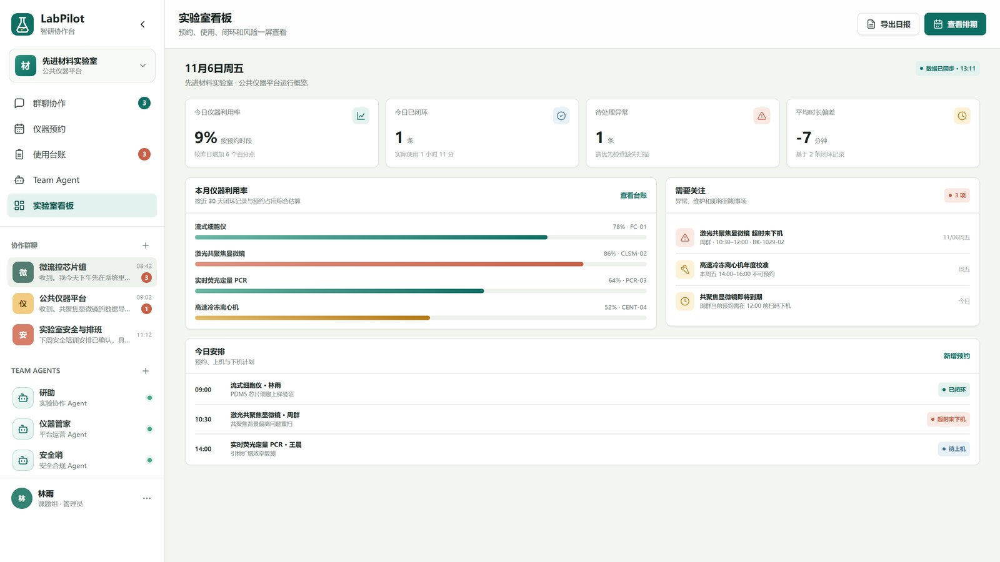
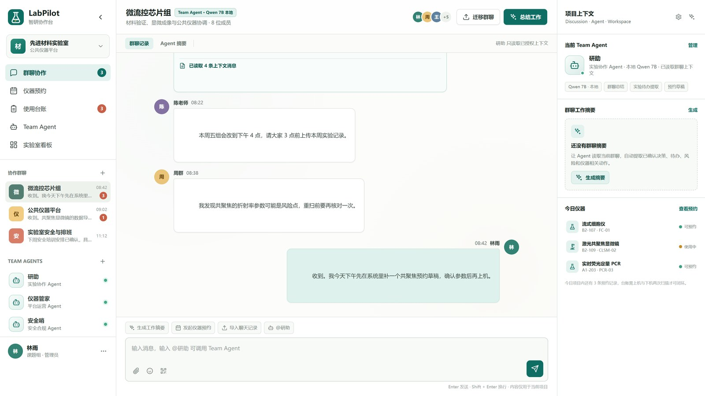
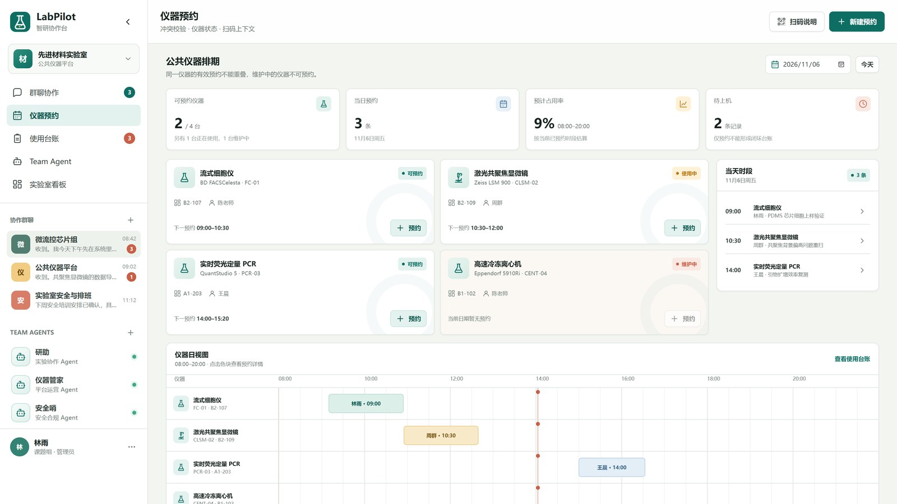
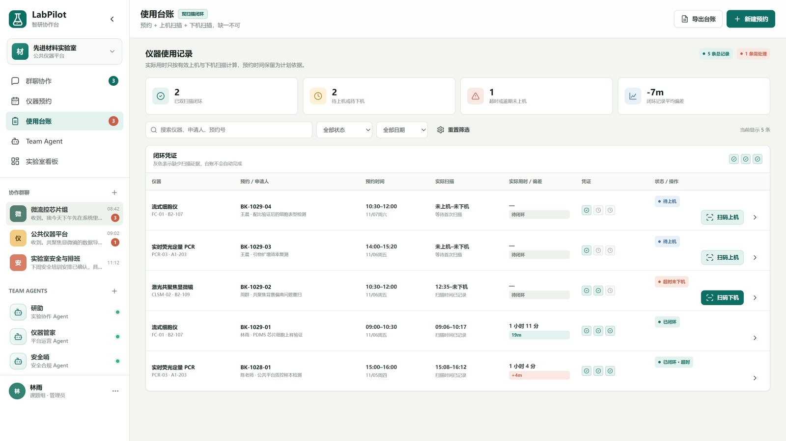

# LabPilot 智研台

> 面向科研实验室的仪器协作平台：把「讨论 → 预约 → 上机 → 台账 → 复盘」串成一条可追溯的数据链。
>
> 纯前端静态 SPA + 零依赖 Node 服务 + 本地大模型，全链路不依赖任何外部云服务。



---

## 一、它解决什么问题

实验室里真正浪费时间的，不是实验本身，而是三处断裂：

| 断裂 | 表现 | 后果 |
|---|---|---|
| **讨论与执行分离** | 参数、结论散落在群聊里，三天后没人记得谁定的 | 重复试错，返工 |
| **预约与实际使用分离** | 约了没来、来了超时、提前下机，没人记录 | 利用率失真，机时纠纷 |
| **数据与原文分离** | 台账只有一行结论，查不到当时的上下文 | 无法复现，审计困难 |

LabPilot 的做法不是再堆一个管理系统，而是**让这五件事共用同一条记录**：群聊里说过的话，可以被摘要成带出处的结论；结论对应的机时，在预约表里能查到；上机扫码产生的记录，又自动落成台账的一行。

---

## 二、五个模块，一条数据链

### 1. 看板

今日安排、仪器状态、需要关注的事项集中在一屏。超时未下机、即将到期这类异常会被顶到最前面。


### 2. 群聊协作

按仪器 / 课题组分组的讨论区。价值不在聊天本身，而在于**讨论可以被压缩成结论**——见下一节。



### 3. Team Agent · 可溯源摘要

点一下「生成摘要」，本地 7B 模型把一段讨论压成几条结论，每条都带 `messageId`。

- 点结论上的「查看消息证据」，直接跳回原话并高亮；
- 模型编造的 `messageId` 会被后端**直接丢弃**——宁可少一条，也不留一条无法核对的；
- 模型不可用时自动降级为规则摘要，接口永远返回 200，界面不会白屏。

### 4. 预约

按仪器 × 时段的排期视图。提交时**当场校验冲突**，撞了就报出具体冲突单号和时间段，不用等人站到仪器前面才发现。



### 5. 台账

扫码上机 / 下机，自动记录实际起止时间和时长。**台账里没有任何一个字段需要人工填写。**



---

## 三、快速开始

### 前置条件

- Node.js **≥ 20**（零 npm 依赖，不需要 `npm install`）
- 可选：Ollama + 一个 7B 模型（不装也能跑，摘要会自动降级为规则引擎）

### 方式一：本机直接跑（推荐用于开发）

```bash
node --env-file-if-exists=.env server/index.js
# 或
npm start
```

打开 <http://127.0.0.1:8080>。

Windows 下也可直接双击 `start.cmd`，它会一并拉起 Ollama、Web 服务和内网穿透，并写 `CURRENT_URL.txt` 记录当前外网地址。

### 方式二：Docker

```bash
# AMD / Intel 核显，或只想看界面（Ollama 跑在宿主机）
docker compose -f docker-compose.yml -f docker-compose.host-ollama.yml up -d

# NVIDIA 独显
docker compose -f docker-compose.yml -f docker-compose.nvidia.yml up -d
```

**注意**：容器拿不到 AMD / Intel 核显的加速，容器内 Ollama 只能纯 CPU，慢 3~5 倍。核显机器请用 `host-ollama` 组合，让推理留在宿主机。详见 [docs/docker-guide.md](docs/docker-guide.md)。

### 接本地 Ollama

```bash
ollama pull qwen2.5:7b-instruct-q4_K_M
```

AMD 核显（如 Radeon 780M）**必须**加一个环境变量，否则 Ollama 会默认丢弃核显、退回 CPU：

```bash
set OLLAMA_IGPU_ENABLE=1
set OLLAMA_MODELS=<你的模型目录>
```

配好后 `GET /api/health` 会显示 `ollama: up` 和当前加载的模型名。本机实测（780M 核显）：**6.5 tok/s**，一次完整摘要约 50~60 秒。

---

## 四、技术架构

```
浏览器（原生 HTML/CSS/JS，无框架无构建）
        │  state 全量存 localStorage，事件委托 data-action
        ▼
Node 22 零依赖 HTTP 服务（server/）
        │  /api/agent/summarize · /api/health
        ▼
Ollama（本地 7B，Vulkan / CUDA）
```

| 层 | 实现 | 说明 |
|---|---|---|
| 前端 | `index.html` + `app.js` + `styles.css` | 无框架、无构建步骤，改完刷新即生效 |
| 服务 | `server/index.js` | 零 npm 依赖，只用 Node 内置模块 |
| 校验 | `server/schema.js` | 手写校验 + `messageId` 白名单，模型幻觉直接过滤 |
| 降级 | `server/fallback.js` | 模型不可用时走规则摘要，接口契约不变 |
| 模型 | Ollama + qwen2.5 7B | 本机推理，不出网 |

**两个关键工程处理**：

1. **摘要接口先发响应头 + 每 5 秒心跳**。7B 在核显上生成一次要 50 秒以上，中间没有任何字节，Cloudflare 隧道会判定超时并断开整条连接。服务端在开始生成前就把响应头写出去，之后周期性写一个空格维持 chunked 连接。
2. **状态只在 localStorage 里**。这是刻意的：整个应用可以当成一个静态页面拷走，不依赖数据库，适合演示和离线使用。要产品化，把 store 换成 API 即可，调用点已经收敛。

---

## 五、目录结构

```
.
├── index.html              单页入口
├── app.js                  全部前端逻辑（约 3000 行）
├── styles.css
├── server/                 零依赖后端
│   ├── index.js            路由 / 摘要 / 心跳
│   ├── prompt.js           提示词与上下文拼装
│   ├── schema.js           输出校验（messageId 白名单）
│   ├── fallback.js         规则摘要降级
│   └── static.js           静态文件服务
├── scripts/                启动、守护、隧道脚本
├── docker-compose*.yml     三种部署形态
└── docs/
    ├── tech-plan-ollama-backend.md   本地大模型接入技术方案
    ├── docker-guide.md               Docker 部署指南
    └── screenshots/                  README 配图
```

---

## 六、已知限制

- **当前是演示形态**：数据存在 `localStorage`，没有账号体系，多端不同步。刷新页面状态保留，换浏览器就没了。
- **不是 LIMS**：不做样品管理、试剂管理、合规审计链。它管的是「人和仪器的时间」。
- **不是 SaaS**：没有多租户、没有权限模型的多层隔离。
- **核显性能有限**：7B Q4 在 780M 上约 6.5 tok/s，一次摘要 50~60 秒。追求速度换 4B 模型。
- **已知 bug**：扫码上机后台账状态变为「使用中」，但看板「今日安排」仍显示「待上机」，两处状态未同步。

---

## 七、更多文档

- [本地大模型接入与后端架构技术方案](docs/tech-plan-ollama-backend.md)
- [Docker 部署指南](docs/docker-guide.md)
