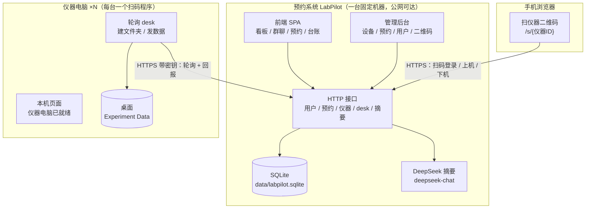
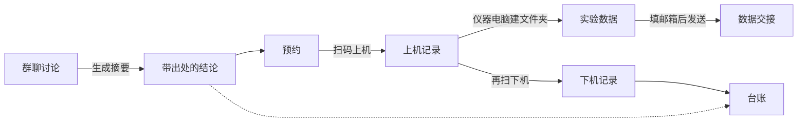
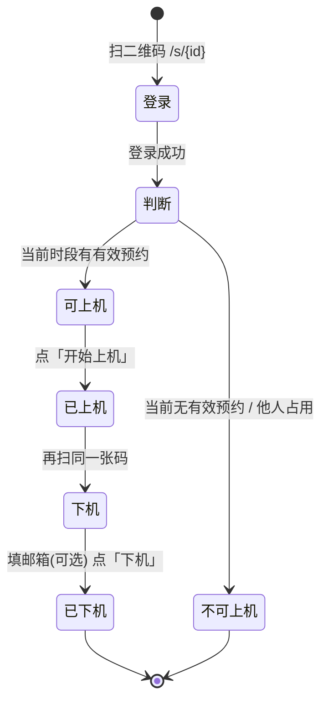
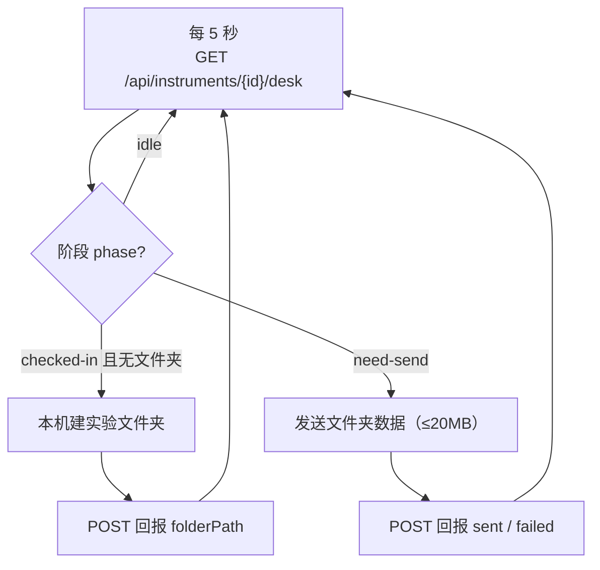
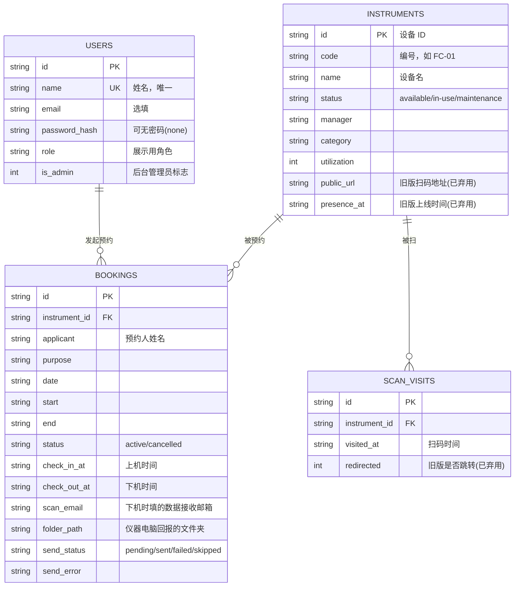

# LabPilot 功能导图

> 预约系统（LabPilot）+ 仪器电脑扫码程序（lab-scan-agent）+ 手机扫码，串成「预约 → 上机 → 台账 → 数据交接」闭环。

## 1. 系统总架构

- **预约系统是被连接方**：跑在一台固定机器上，通过 Cloudflare quick tunnel 暴露公网地址。
- **仪器电脑是主动连接方**：只要能上网即可，不需要公网 IP，主动轮询预约系统。
- **手机只连预约系统**：扫二维码后全程停留在预约系统，不再跳到仪器电脑。

## 2. 核心数据链

## 3. 手机扫码状态机

## 4. 仪器电脑轮询

- 没填邮箱或没配置发信邮箱时，不发送，只记录原因。
- 每个预约只处理一次；回报失败会重试，不会重复建文件夹或重复发信。

## 5. 数据模型

## 6. 模块职责

| 模块 | 归属 | 职责 |
|---|---|---|
| 看板 / 群聊 / 预约 / 台账 | LabPilot 前端 | 用户交互，状态存 localStorage |
| 用户 / 预约 / 仪器 / desk 接口 | LabPilot 后端 | 数据读写、鉴权 |
| 摘要 | LabPilot + DeepSeek | 讨论压缩成可溯源结论 |
| 手机扫码页 `/s/:id` | LabPilot | 登录、判预约、上机、下机 |
| 扫码程序 | 仪器电脑 | 轮询 desk、建文件夹、发数据 |
