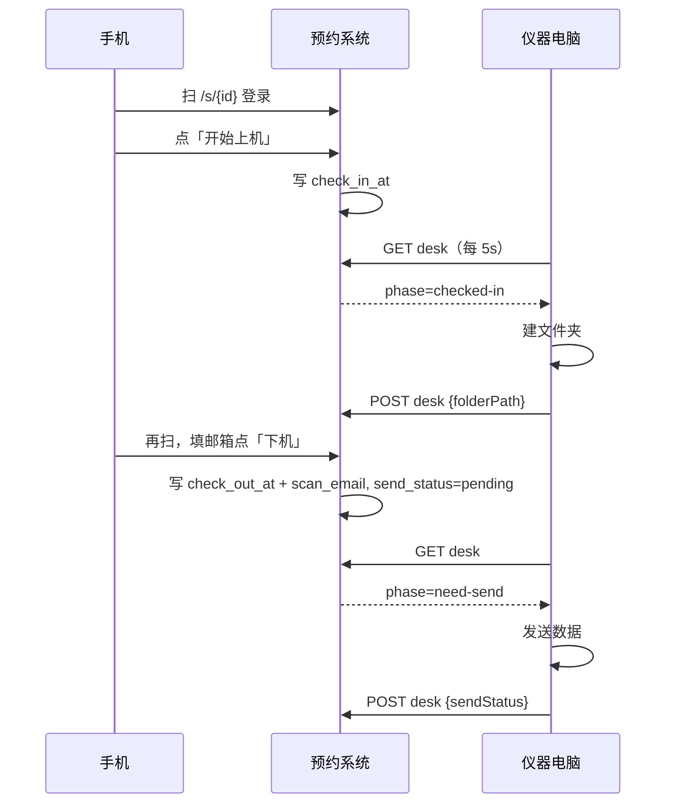

# LabPilot 技术文档

> 面向开发与部署。系统由两个仓库组成：预约系统（本仓库 `labpilot`）和仪器电脑扫码程序（`lab-scan-agent`）。功能总览见 [功能导图](./功能导图.md)，操作步骤见 [使用说明](./使用说明.md)。

## 1. 两个组件

| 组件 | 仓库 | 技术栈 | 位置 |
|---|---|---|---|
| 预约系统 | `lglunl/labpilot`（私有） | Node.js 24，零 npm 依赖，`node:sqlite` | 一台固定机器，公网可达 |
| 扫码程序 | `lglunl/lab-scan-agent`（公开） | Python 3.12 FastAPI + urllib | 每台仪器电脑一份 |

- 预约系统监听 `127.0.0.1:8080`，通过 Cloudflare quick tunnel 暴露公网。
- 扫码程序监听 `127.0.0.1:8787`，主动轮询预约系统，不需要公网。

## 2. 目录结构

```
labpilot/
├── server/
│   ├── index.js       路由、鉴权、摘要队列、心跳
│   ├── db.js          SQLite 建表、种子数据、数据访问 API
│   ├── phone.js       手机扫码页 HTML 模板
│   ├── prompt.js      摘要提示词
│   ├── schema.js      摘要输出校验（messageId 白名单）
│   ├── fallback.js    摘要降级（规则引擎）
│   └── static.js      静态文件服务
├── index.html / app.js / styles.css   前端 SPA（无框架）
├── data/labpilot.sqlite               数据库（gitignore）
├── .env                               密钥配置（不要提交）
└── docs/
```

```
lab-scan-agent/
├── labcheckin/
│   ├── main.py        FastAPI 入口（本机状态页）
│   ├── agent.py       轮询 desk、建文件夹、发数据
│   ├── booking.py     预约系统 HTTP 客户端
│   ├── config.py      配置加载
│   └── db.py          本地会话存储（旧版遗留）
├── scripts/start-device.ps1   便携 Python + 首次配置弹窗
├── start.cmd          双击入口
├── config.json        设备配置（密钥可留空走环境变量）
└── templates/ static/ 本机页面模板
```

## 3. 数据模型（SQLite，`node:sqlite`）

四张表，字段见 [功能导图 §5](./功能导图.md#5-数据模型)。要点：

- `users.password_hash` 为 `none` 表示无密码账号；无密码账号只接受空密码登录。
- `bookings` 上机/下机状态由 `check_in_at` / `check_out_at` 表示；发送链路在 `scan_email` / `folder_path` / `send_status` / `send_error`。
- `instruments.public_url` / `presence_at`、`scan_visits.redirected` 是旧版「手机跳转到设备」方案的遗留字段，保留但不参与新流程。
- 迁移用 `ensureColumn`：列不存在时 `ALTER TABLE ADD COLUMN`，平滑升级。

## 4. 鉴权

三类凭证，互不混用：

| 凭证 | 来源 | 用途 |
|---|---|---|
| `LAB_API_TOKEN`（机器密钥） | 预约系统 `.env`，与所有仪器电脑一致 | 设备轮询 / 回报 desk、presence、verify |
| 用户会话 token | `POST /api/users/login` / `register` 返回 | 前端和手机扫码页 |
| 管理员会话 | `POST /api/admin/login` 返回，内存态 12h TTL | 管理后台接口 |

- `authorize(req)`：接受 `LAB_API_TOKEN` 或任意有效会话 token；未配置 token 时放行（仅限本机联调）。
- `authorizeAdmin(req)`：要求会话 `isAdmin`。
- 会话存内存 `Map`，**重启即失效**。

## 5. API 清单

### 公开（无需鉴权）

| 方法 | 路径 | 说明 |
|---|---|---|
| GET | `/api/health` | 健康检查、模型配置状态 |
| POST | `/api/users/register` | 注册（姓名必填，密码/邮箱可选），返回 token |
| POST | `/api/users/login` | 登录，返回 token |
| GET | `/api/instruments` | 仪器列表（公开读） |
| GET | `/api/bookings/instrument/:id` | 某仪器预约（公开读） |
| GET/POST | `/s/:id` 及 `/s/:id/{login,check-in,check-out,in,out}` | 手机扫码页（HTML 表单流） |
| POST | `/api/agent/summarize` | 讨论摘要（DeepSeek） |

### 需 Bearer（机器密钥或会话）

| 方法 | 路径 | 说明 |
|---|---|---|
| POST | `/api/users/verify` | 校验用户名/密码（扫码程序旧登录用） |
| GET | `/api/users/me` | 当前会话用户 |
| GET | `/api/bookings/active?instrument=&user=&date=&time=` | 查当前有效预约 |
| POST | `/api/bookings` | 创建预约 |
| POST | `/api/bookings/:id/scan` | 回写上机/下机（action=check-in/check-out） |
| POST | `/api/bookings/:id/cancel` | 取消预约 |
| GET | `/api/instruments/:id/desk` | **设备轮询**：返回 `{phase, booking}` |
| POST | `/api/instruments/:id/desk` | **设备回报**：`{bookingId, folderPath?, sendStatus?, sendError?}` |
| POST | `/api/instruments/:id/presence` | 旧版设备地址登记（已弃用） |

### 管理后台（管理员会话）

| 方法 | 路径 | 说明 |
|---|---|---|
| POST | `/api/admin/login` | 管理员登录 |
| GET/POST | `/api/admin/instruments` | 设备列表 / 新增 |
| PUT/DELETE | `/api/admin/instruments/:id` | 修改 / 删除设备 |
| GET | `/api/admin/bookings` | 预约列表 |
| PUT | `/api/admin/bookings/:id` | 修改预约 |
| POST | `/api/admin/bookings/:id/cancel` | 取消预约 |
| GET | `/api/admin/users` | 用户列表 |
| GET | `/api/admin/instruments/:id/qr.svg` | 下载仪器二维码 |

### desk 接口契约

`GET /api/instruments/:id/desk` 返回：

```json
{ "ok": true, "phase": "idle | checked-in | need-send", "booking": { "id": "BK-...", "applicant": "...", "checkInAt": "...", "checkOutAt": "...", "email": "...", "folderPath": "...", "sendStatus": "..." } }
```

- `checked-in`：有已上机未下机的预约（`check_in_at` 有值、`check_out_at` 空）。
- `need-send`：已下机且 `send_status='pending'`（填了邮箱待发送）。
- `idle`：其余情况。

`POST` 回报 `folderPath`（上机建夹后）、`sendStatus`（`sent|failed|skipped`）与 `sendError`。

## 6. 配置

### 预约系统 `.env`（`D:\cursor_home\labpilot\.env`，勿提交）

| 变量 | 说明 |
|---|---|
| `PORT` / `HOST` | 监听地址，默认 8080 / 127.0.0.1 |
| `LLM_BASE_URL` | DeepSeek 接口，默认 `https://api.deepseek.com` |
| `LLM_API_KEY` | DeepSeek key |
| `LLM_MODEL` | 默认 `deepseek-chat` |
| `LAB_API_TOKEN` | 机器密钥，所有仪器电脑共用 |
| `PUBLIC_BASE_URL` | 二维码编码用的公网地址，末尾不加 `/` |

### 扫码程序 `config.json`

| 字段 | 说明 |
|---|---|
| `instrument_id` | 这台电脑对应的设备 ID |
| `booking_api_base` | 预约系统公网地址，与 `PUBLIC_BASE_URL` 相同 |
| `booking_api_token` | 密钥（可留空，走环境变量 `LAB_API_TOKEN` 优先） |
| `smtp_*` | 发信邮箱；不配则不真正发信，只记录失败原因 |
| `max_attachment_bytes` | 附件上限，默认 20MB |

## 7. 部署

- 预约系统：`node --env-file-if-exists=.env server/index.js`；另开窗口跑 cloudflared quick tunnel。改 `.env` 后要重启 node（`node --env-file` 不覆盖已设环境变量）。
- 扫码程序：双击 `start.cmd`。第一次弹窗填设备 ID + 密钥，自动下载便携 Python 3.12.8 并装依赖。之后直接启动。

## 8. 关键数据流



## 9. 已知限制 / 待办

- 预约系统仍是 **private** 仓库，quick tunnel 地址每次重启会变（固定域名待做，见 `docs/TODO.md`）。
- 管理员默认密码 `admin123`，上线前要改；目前没有改密码界面。
- 管理员会话存内存，重启失效。
- 数据层 SQLite，后续迁 MySQL（见 `docs/TODO.md`）。
- 发信邮箱未配置前，数据发送只会记录失败原因，不真正发信。
